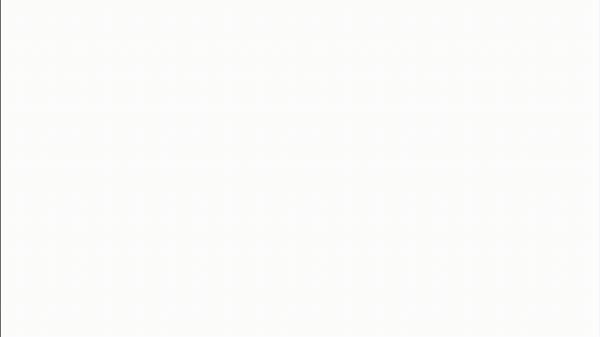

# OverwatchProgress
[](https://android-arsenal.com/details/1/5722)
[](https://jitpack.io/#zjywill/OverwatchProgress)
[](http://developer.android.com/index.html)
[](https://android-arsenal.com/api?level=24)  

Have you ever played Overwatch and amazed by the beautiful loading view,  now you can use in your android application.  




# Example
```
<com.comix.overwatch.HiveProgressView
    xmlns:app="http://schemas.android.com/apk/res-auto"
    android:layout_width="192dp"
    android:layout_height="192dp"
    android:layout_gravity="center"
    app:hive_animDuration="5000" //animation duration
    app:hive_color="@color/colorAccent" //color of hexagon
    app:hive_maxAlpha="255" //hexagon animation max alpha, from 0-255
    app:hive_rainbow="true" //rainbow style
    app:hive_cornerRadius="20" //radius of the corner
    app:hive_shrink="true" //shrink the hexagon
    app:hive_image="@drawable/cat" //any image resource you like
    app:hive_spacing="8dp" //NEW gap between hexagons, omit for a size-proportional default
    />
```

# Installation

In `settings.gradle.kts`:
```kotlin
dependencyResolutionManagement {
  repositories {
    google()
    mavenCentral()
    maven { url = uri("https://jitpack.io") }
  }
}
```

In the module's `build.gradle.kts`:
```kotlin
dependencies {
  implementation("com.github.zjywill:OverwatchProgress:2.0.0")
}
```

Check the [JitPack page](https://jitpack.io/#zjywill/OverwatchProgress) for the coordinates of the
newest release: `2.1.0` adds a second artifact for the Compose API, and JitPack names artifacts
differently once a repository publishes more than one module.

> The coordinate is unchanged from `1.6`, so upgrading is a version bump. `2.0.0` requires JDK 17
> and raises `minSdk` to 24.

# Compose

```kotlin
HiveProgress(
  modifier = Modifier.size(160.dp),
  colors = HiveProgressDefaults.Rainbow,
  spacing = 8.dp,
  cornerRadius = 6.dp,
  shrink = true,
)
```

There is also a stateless overload that takes the wave position instead of animating itself, which
is what makes the comb a pure function of its arguments — useful for screenshot tests, or for
driving the wave from your own animation:

```kotlin
HiveProgress(progress = 420f, modifier = Modifier.size(160.dp))
```

Both renderers share [`HiveGeometry`](overwatch/src/main/java/com/comix/overwatch/HiveGeometry.java),
so the comb layout and the fade wave cannot drift apart between them. The Compose version reports
itself as an indeterminate progress indicator to accessibility services.

# Spacing

`hive_spacing` is the gap between two neighbouring hexagons, and it applies uniformly in all six
directions — the cells hold *relative* comb coordinates, and the gap propagates through the
horizontal pitch (`√3·r + spacing`) and the row step (`1.5·r + √3·spacing/2`). The hexagons shrink
to absorb the gap, so the comb always fits the view.

It can also be driven at runtime:

```java
hiveProgressView.setSpacingDp(12);  // dp
hiveProgressView.setSpacing(30f);   // raw pixels
hiveProgressView.setSpacing(-1f);   // back to the size-proportional default
```

# License
```
Copyright [2017] [Junyi Zhang]

Licensed under the Apache License, Version 2.0 (the "License");
you may not use this file except in compliance with the License.
You may obtain a copy of the License at

    http://www.apache.org/licenses/LICENSE-2.0

Unless required by applicable law or agreed to in writing, software
distributed under the License is distributed on an "AS IS" BASIS,
WITHOUT WARRANTIES OR CONDITIONS OF ANY KIND, either express or implied.
See the License for the specific language governing permissions and
limitations under the License.
```
